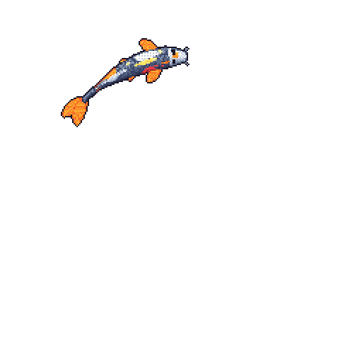

  

### Hi, I'm Jake Kubicki

Software engineer building real-time, scalable systems: data-driven platforms for factory automation, national security, and consumer tech, plus games and tools on the side.

- Portfolio and playable demos: [jrkubic.github.io](https://jrkubic.github.io)
- LinkedIn: [jonathan-k-094352221](https://www.linkedin.com/in/jonathan-k-094352221)
- Email: [jakekubicki2@gmail.com](mailto:jakekubicki2@gmail.com)

The koi above is redrawn every night by <a href="https://github.com/yalongwastaken/git-koi">git-koi</a>: its colors come from the languages I write, its size from my contributions, its markings from my streaks, and the lily pads and rocks around it from the issues and pull requests I opened this week.
